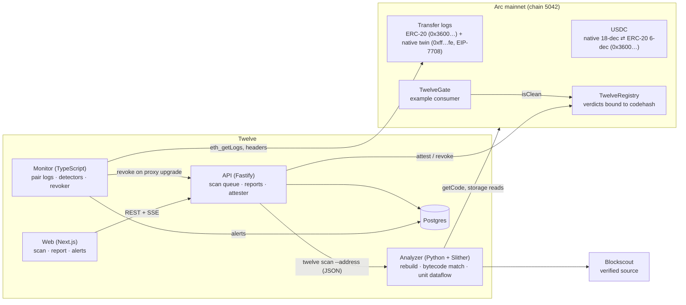

# Twelve

**Arc's decimal-safety layer: catch the 10¹² bug before deploy, flag it live after.**

[Live app](https://twelve-arc.vercel.app) · [How to use it](USERFLOW.md) · [Architecture](docs/ARCHITECTURE.md) · [Decisions](docs/DECISIONS.md)

Twelve finds the line of Solidity where Arc's two USDC units get mixed, records the verdict on-chain bound to the
contract's code, watches every USDC movement on Arc mainnet for the same mistake in live transactions, and ships Solidity
types that make the mistake impossible to compile.

---

## The problem

On Arc, USDC is the native gas token **and** an ERC-20, and they are the same balance seen through two interfaces:

| View | Where you meet it | Decimals | 1 USDC as a raw integer |
|---|---|---|---|
| **Native** | `msg.value`, `address.balance`, `call{value:}`, `eth_getBalance`, gas | 18 | `1000000000000000000` |
| **ERC-20** | `balanceOf` / `transfer` / `transferFrom` / `approve` on `0x3600000000000000000000000000000000000000` | 6 | `1000000` |

The raw integers differ by exactly **10¹²**. On Ethereum or Base, ETH and USDC are different assets, so code ported from
there freely sends "the USDC amount" as `msg.value`, or compares `msg.value` with `USDC.balanceOf(...)`. On Arc
that code compiles, deploys and runs, but it is wrong by a factor of a trillion:

- **Underpay (dust).** A refund of `paid6` USDC sent natively arrives as `paid6 × 10⁻¹²` USDC. Pay 0.1 USDC, get back
  `0.0000000000001`.
- **Overpay (drain).** A native amount credited and later paid out through the ERC-20 asks for 10¹² times too much. If
  the contract holds enough, it pays it.
- **Broken checks.** Collateral, LTV and price comparisons between the two views are off by 10¹², so they always pass
  or always fail.

Arc's own documentation warns against mixing `msg.value` with `USDC.balanceOf()`. Until now nothing enforced it. And
because the problem comes from Arc's ledger design, generic EVM tools don't look for it.

## The solution: four layers against one bug

| Layer | When | What it does |
|---|---|---|
| **Analyzer** (`analyzer/`) | Before deploy, and for any verified mainnet contract | Tracks the decimal unit of every USDC value through the compiled contract (Slither IR dataflow) and stops at the exact expression where 6 meets 18, with a unit trace and a fix. For deployed contracts it first rebuilds the verified source and proves the bytecode matches what's on-chain. |
| **Registry** (`contracts/src/TwelveRegistry.sol`) | On-chain, for anyone | Stores each verdict bound to the contract's `extcodehash`. Change the code and the attestation goes STALE on its own. Any contract can call `isClean(attester, target)`. No owner, no proxy, no admin. |
| **Monitor** (`apps/monitor/`) | After deploy, in real time | Reads Arc's own USDC Transfer logs, pairs each ERC-20 log with its native twin, and flags the fingerprint: the same raw integer entering a contract through one view and leaving through the other. Needs no source code, so it covers unverified contracts too. Revokes attestations when an attested proxy is upgraded. |
| **Guard** (`contracts/src/guard/`) | In your code | `Usdc6` / `Usdc18` user-defined value types with operators, so `Usdc6 + Usdc18` is a **compile error**. Conversions return the dust instead of dropping it, and `TwelvePayout` reverts untyped legacy payouts whose two units disagree. |

### Seen live on Arc mainnet

A deliberately broken demo shop, `LeakyRefund`, takes payment through the ERC-20 and refunds natively without
converting.

1. **Analyzer:** `TW-003 · HIGH` on `call{value: paid6}`, with the trace `paid6 [6 dec, from transferFrom] → call{value} expects [18 dec]`.
2. **Registry:** attested `FINDINGS`, so `TwelveGate.forward` to it reverts `TargetNotClean(target, FINDINGS)`.
3. **Monitor:** a 0.01 USDC purchase came back as `0.00000000000001` USDC, and alert `D1 · HIGH · Cross-view raw equality` was stored
   **1.84 s after the block** (0.94 s with a 250 ms poll).
4. **Guard:** the typed twin `FixedRefund` uses `Usdc.toNative(paid)`, scans **CLEAN**, and refunds exactly what was paid.

Evidence: [`docs/evidence/phase6-mainnet-demo.md`](docs/evidence/phase6-mainnet-demo.md).

---

## Architecture



### Scan pipeline

```
QUEUED → RESOLVING → FETCHING → REBUILDING → COMPILING → MATCHING → BINDING → ANALYZING → HASHING → ATTESTING → DONE
```

- **Matching:** a report is only ever about code that is actually deployed (invariant I5). The rebuilt bytecode must
  equal the on-chain bytecode once immutables are masked and metadata stripped. Otherwise: `MATCH_FAILED`, no report, no
  attestation.
- **Binding:** finds which state variables, immutables or constants hold `0x3600…`, so `USDC.transfer(...)` is
  recognised however the address got there.
- **Hashing:** `reportHash = keccak256(JCS(reportCore))` (RFC 8785). The analyzer is deterministic: same input and
  same tool give byte-identical reports, so anyone can recompute the hash that's on-chain.
- Every other outcome is terminal and explained in plain words: `NOT_A_CONTRACT`, `NOT_VERIFIED`, `UNSUPPORTED`,
  `COMPILE_FAILED`, `FETCH_FAILED`, `ANALYZER_ERROR`, `ATTEST_FAILED`, `WITHHELD`.

### Analyzer rules

| Rule | Catches | Severity |
|---|---|---|
| TW-001 | `+` / `-` between a 6-dec and an 18-dec amount | HIGH |
| TW-002 | A comparison, `min` or `max` between the two views | HIGH |
| TW-003 | A 6-dec value reaching `call{value}` / `transfer` / `send` (underpay) | HIGH |
| TW-004 | An 18-dec value reaching the ERC-20 `transfer` / `transferFrom` / `approve` (overpay) | HIGH |
| TW-005 | One storage slot written with both views | HIGH / MEDIUM |
| TW-006 | A hard-coded amount in the other view | MEDIUM |
| TW-007 | 18 → 6 conversion whose dust is never accounted for | INFO |
| TW-008 | A conversion applied in the wrong direction (exponent outside [0, 18]) | LOW |
| TW-900 | An unresolved token mixed with USDC math | INFO |

Precision beats coverage. A rule that fires on safe code is worse than no rule, so uncertain cases are reported at
lower confidence or not at all. Each bug is reported once, at its root cause.

### Monitor detectors

| Detector | Signal | Severity |
|---|---|---|
| D1 · Cross-view raw equality | In one transaction, the same raw integer enters through one view and leaves through the other | HIGH |
| D2 · Dust outflow | A contract's typical payout arrives × 10⁻¹² natively | MEDIUM |
| D3 · Abnormal sweep | A contract that never moves more than 10% of its balance sends out ≥ 90% at once | MEDIUM |
| D4 · Attested proxy upgraded | The implementation changed; the attestation is revoked and a rescan starts | INFO |
| D5 · Funds into a flagged contract | USDC flowing into a contract attested with findings | INFO |

Arc's ledger makes this possible. A single ERC-20 `transfer()` emits two `Transfer` logs: one 6-dec from `0x3600…`
and one 18-dec from the system emitter `0xffff…fffe`. Native sends emit only the 18-dec one. Pairing the two tells the
monitor which interface every movement used.

---

## Measured results

Every number here is produced by the current tool and committed in the repo.

| Result | Value | Source |
|---|---|---|
| High-severity planted bugs caught | **14 / 14** (11 source, 3 deployed on Arc testnet) | [`corpus/METRICS.md`](corpus/METRICS.md), [`METRICS.deployed.md`](corpus/METRICS.deployed.md) |
| High-severity alarms on fixed twins and hard negatives | **0** | same |
| Mainnet history replayed through the monitor | **67,687,598** Transfer logs · 43,040,670 movements · 1,249,355 addresses | [`docs/MONITOR.md §9`](docs/MONITOR.md) |
| D1 fingerprint alerts over all of mainnet history | 49 alerts on 4 contracts, **0 false positives** | same |
| Verified mainnet contracts rebuilt and matched to on-chain bytecode | **15 / 15** | [`docs/evidence/phase2-mainnet-sample.md`](docs/evidence/phase2-mainnet-sample.md) |
| Block → alert, mainnet | 0.94 s (250 ms poll) · 1.84 s (400 ms poll) | [`phase4`](docs/evidence/phase4-testnet-exits.md), [`phase6`](docs/evidence/phase6-mainnet-demo.md) |
| Cost of one attestation | ≈ 0.0025 USDC | [`docs/REGISTRY.md §4.4`](docs/REGISTRY.md) |

Real issues found in third-party contracts are going through responsible disclosure. They are counted, never named,
until their owners have had the chance to fix them ([`docs/CORPUS_AND_TESTING.md §7`](docs/CORPUS_AND_TESTING.md)).

---

## Deployed on Arc mainnet (chain 5042)

| Contract | Address |
|---|---|
| TwelveRegistry | [`0x6670030e9df18e3A454eA77d69D00Fd8d17728A1`](https://explorer.arc.io/address/0x6670030e9df18e3A454eA77d69D00Fd8d17728A1) |
| TwelveGate | [`0x7a63d663861f84cd0F6F66DE29945620C1Cc95b7`](https://explorer.arc.io/address/0x7a63d663861f84cd0F6F66DE29945620C1Cc95b7) |
| Twelve attester (EOA) | [`0xe98540d28F45830E01D237251Bfc4777E69c9A46`](https://explorer.arc.io/address/0xe98540d28F45830E01D237251Bfc4777E69c9A46) |
| LeakyRefund (demo, the bug) | [`0xA6c15eDC8ceffb558A54ead5bd9d833A589276bC`](https://explorer.arc.io/address/0xA6c15eDC8ceffb558A54ead5bd9d833A589276bC) |
| FixedRefund (demo, typed fix) | [`0x62e325C4aaB5f3808DCAaFb71d932f4E97455368`](https://explorer.arc.io/address/0x62e325C4aaB5f3808DCAaFb71d932f4E97455368) |
| OverpayVault (demo, guarded) | [`0xc2Dc300E524Cb9Ee18887E7c2333D24403dF076A`](https://explorer.arc.io/address/0xc2Dc300E524Cb9Ee18887E7c2333D24403dF076A) |

All are verified on Blockscout. The demo contracts are labelled *DELIBERATELY VULNERABLE: do not send funds*.

---

## Use it

### In the browser

Open **https://twelve-arc.vercel.app**, paste a verified Arc mainnet contract address, and press **Scan**. Or browse
[`/alerts`](https://twelve-arc.vercel.app/alerts), [`/corpus`](https://twelve-arc.vercel.app/corpus) and
[`/integrate`](https://twelve-arc.vercel.app/integrate). The full walkthrough is in [`USERFLOW.md`](USERFLOW.md).

### In Solidity: refuse native USDC into flagged contracts

```solidity
import {ITwelveRegistry} from "twelve/interfaces/ITwelveRegistry.sol";

ITwelveRegistry constant REGISTRY = ITwelveRegistry(0x6670030e9df18e3A454eA77d69D00Fd8d17728A1);
address constant ATTESTER = 0xe98540d28F45830E01D237251Bfc4777E69c9A46;

if (!REGISTRY.isClean(ATTESTER, target)) revert TargetNotClean(target, REGISTRY.status(ATTESTER, target));
(bool ok,) = target.call{value: msg.value}(data);
```

`isClean` is true only for a CLEAN verdict on the code the target has **right now**.

### In your code: make the bug unrepresentable

```solidity
import {Usdc, Usdc6, Usdc18} from "twelve/guard/Usdc.sol";

function refund(address payable to, Usdc6 paid) internal {
    Usdc.sendNative(to, Usdc.toNative(paid));   // converts: exactly the same value, native view
    // Usdc.sendNative(to, paid);               // does not compile: Usdc6 is not Usdc18
}
```

### Before deploy, in CI

```bash
uv run --project analyzer twelve scan path/to/contracts --fail-on HIGH
```

### Verify a report yourself

```bash
curl -so report.json "$API/v1/reports/<reportHash>"
uv run --project analyzer twelve verify --report report.json   # MATCH recomputed 0x… claimed 0x…
```

The report records the analyzer commit that produced it. If `verify` prints a `git checkout …` line, run it and
verify again.

---

## Run it locally

**Requirements:** Node 22 + pnpm, Python 3.12 + [uv](https://docs.astral.sh/uv/), [Foundry](https://getfoundry.sh),
Docker (for Postgres), an Arc mainnet RPC URL, and a Blockscout Pro API key.

```bash
git clone https://github.com/Samuel1505/Twelve.git && cd Twelve
cp .env.example .env                                # fill in RPC URLs, BLOCKSCOUT_API_KEY, keys (see comments)
pnpm i && (cd analyzer && uv sync) && (cd contracts && forge install)
docker compose -f infra/compose.yml up -d           # Postgres

pnpm --filter @twelve/api dev                       # API + scan worker + attester   → :8787
pnpm --filter @twelve/monitor dev                   # mainnet monitor
pnpm --filter @twelve/web dev                       # web                            → :3000
```

Analyzer only, no services needed:

```bash
cd analyzer
uv run twelve scan ../contracts/src/demo/LeakyRefund.sol --json        # source mode
uv run twelve scan --address 0xA6c15eDC8ceffb558A54ead5bd9d833A589276bC --chain arc --json   # deployed mode
```

### Tests and gates

```bash
scripts/lint-units.sh                                # no bare 1e12/1e18/1e6 outside the three unit modules (I1)
pnpm -r typecheck && pnpm -r test                    # TypeScript: api, monitor, web, shared
cd analyzer && uv run pytest -q && uv run mypy --strict twelve
uv run python -m twelve.metrics ../corpus            # precision/recall table; HIGH recall must stay 100%
cd ../contracts && forge test && script/compile-fail.sh   # guard tests; Usdc6 + Usdc18 must not compile
```

Contract tests in `contracts/test/` run against a local EVM with a **mocked** USDC (labelled as such). Arc-specific
behavior, such as the `0x3600…` interface, the native-coin precompile and EIP-7708 logs, is asserted against Arc
testnet in `contracts/test-arc/`.

### Hosting

The live site runs the web app on Vercel. The API, monitor and database run on the maintainer's machine, published
through a Cloudflare quick tunnel ([`scripts/go-live.sh`](scripts/go-live.sh), [ADR-023](docs/DECISIONS.md)). A
production setup (one Docker image, two process groups, managed Postgres) is ready in [`infra/`](infra/).

---

## Repository layout

```
analyzer/           Python 3.12, Slither-based unit dataflow · `twelve scan | verify | tool | rules`
contracts/          Foundry
  src/TwelveRegistry.sol, TwelveGate.sol
  src/guard/        Usdc.sol (Usdc6/Usdc18, conversions), TwelvePayout.sol
  src/demo/         LeakyRefund, FixedRefund, OverpayVault
  test/, test-arc/  local (mocked) and Arc-testnet tests
apps/api/           Fastify: scans, reports, status, alerts (REST + SSE), webhooks, attester
apps/monitor/       log ingestion, pairing, profiles, detectors D1–D5, revoker
apps/web/           Next.js: scan, report, alerts, corpus, integrate, mainnet results
packages/shared/    chain config, branded Usdc6/Usdc18 amounts, report schema (zod), ABIs
corpus/             planted bugs: cNN_<name>/{bug.sol, safe.sol, expect.json}, plus hard negatives
docs/               specs, ADRs, evidence from each phase
infra/              Dockerfile, fly.toml, compose for local Postgres
```

## Design principles

- **Arc-only by construction.** If a feature would work the same on Base, it's out of scope.
- **One conversion module per language.** Bare `1e12` never appears in code (`scripts/lint-units.sh` enforces it).
  18 → 6 conversions floor and return the dust explicitly.
- **Deterministic and verifiable.** No timestamps, ordering effects or LLM output in the report core. Anyone can
  recompute a `reportHash`.
- **Never report on code that isn't deployed.** Bytecode must match before anything is attested.
- **Trust is a choice, not a role.** The registry has no admin; consumers choose which attester to trust.
- **Honest numbers.** Every metric on the site cites a file in this repo; third-party findings stay private until
  disclosed.

## Limitations

- **Scope.** Twelve covers USDC's two views only. Other decimal mismatches (EURC, cross-currency) are out of scope for v1.
- **Unsupported code.** Vyper, EIP-7702 delegated accounts and assembly-heavy value paths are reported as `UNSUPPORTED`.
  So are a few large verified codebases that trip the pinned Slither version (for example duplicate contract names).
  The monitor still covers all of them.
- **Meaning of CLEAN.** CLEAN means no rule fired, and nothing more. A contract that never references USDC's ERC-20
  interface is trivially CLEAN.
- **Proxies.** For proxies, the registry binds the implementation's codehash, and upgrades are caught by the monitor's
  revoker. On-chain status alone cannot see an implementation swap ([`docs/REGISTRY.md §4.3`](docs/REGISTRY.md)).
- **Uptime.** The current live deployment depends on the maintainer's machine being online.

## Documentation

| Doc | Covers |
|---|---|
| [`docs/ARC_LEDGER.md`](docs/ARC_LEDGER.md) | Arc's USDC model, logs, chain parameters, verified against primary sources |
| [`docs/ARCHITECTURE.md`](docs/ARCHITECTURE.md) | Services, data flow, scan state machine, data model |
| [`docs/ANALYZER.md`](docs/ANALYZER.md) | Unit lattice, sources and sinks, dataflow, rules, report schema |
| [`docs/REGISTRY.md`](docs/REGISTRY.md) | Attestation model, statuses, proxies, costs |
| [`docs/MONITOR.md`](docs/MONITOR.md) | Ingestion, pairing, detectors, false-positive discipline, full-history replay |
| [`docs/GUARD.md`](docs/GUARD.md) | `Usdc6` / `Usdc18`, `TwelvePayout`, gate, demo contracts |
| [`docs/CORPUS_AND_TESTING.md`](docs/CORPUS_AND_TESTING.md) | Corpus, metrics, test strategy, responsible disclosure |
| [`docs/DECISIONS.md`](docs/DECISIONS.md) | Architecture decision records |
| [`USERFLOW.md`](USERFLOW.md) | Step-by-step use of the app |

---

*Twelve: the decimal-safety layer for Arc. It only exists because Arc does.*
